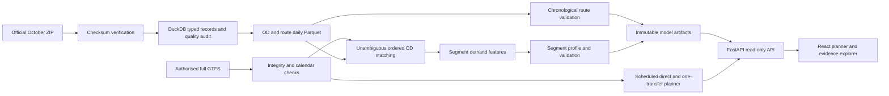

# Architecture

Offline analytics owns the CSV, private diagnostics, DuckDB and Parquet. The API never reads raw transactions or returns vehicle identifiers. Data/models load at startup; rebuilding requires an API restart. Journey cache holds 128 exact query keys; historical profiles are in-memory lookup tables.

The API can run in a degraded state with no network/model. `/health` exposes data and routing readiness. `/stops` returns an explicit unavailable state; journey search returns 503. The frontend still supports real ticket analytics and the evidence screen. No fixture fallback is wired into production.

## Modules

| Module | Responsibility |
|---|---|
| `acquire.py` | Resumable public download, SHA-256 and controlled extraction |
| `ingest.py` | Type validation, diagnostics, complete data profile and aggregates |
| `network.py` | GTFS integrity, route patterns, exact-normalised OD matching, calendar supply counts |
| `pipeline.py` | Artifact generation, matching diagnostics and reproducible evaluation |
| `model.py` | Seasonal means, sparse-history backoff, demand percentiles and evidence heuristics |
| `planner.py` | Schedule search, transfers, scoring and segment decoration |
| `api.py` | Validated inputs, explicit readiness/errors, cache and frontend serving |
| `frontend/src` | Stop search, journey map/details, demand explorer and evidence |

No external account, booking, payment, tracking or administrative system is included.
